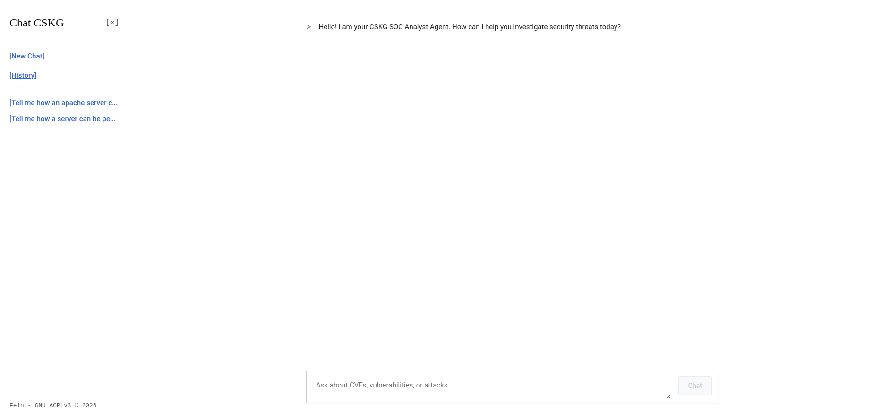
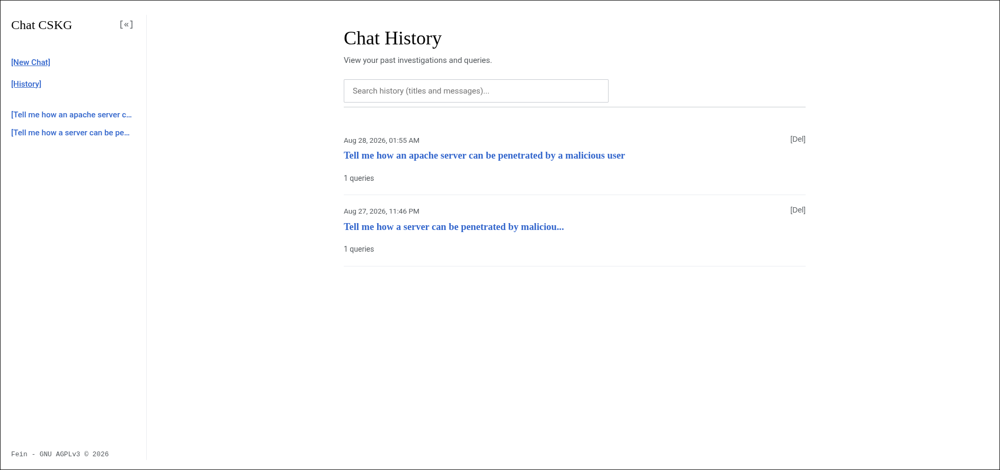
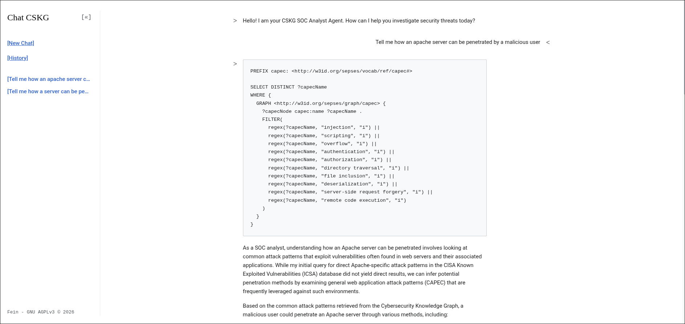
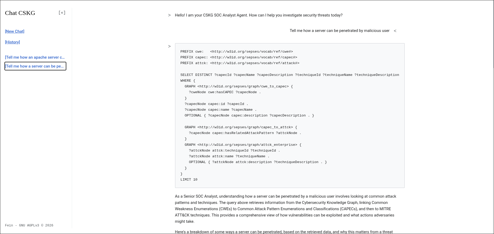
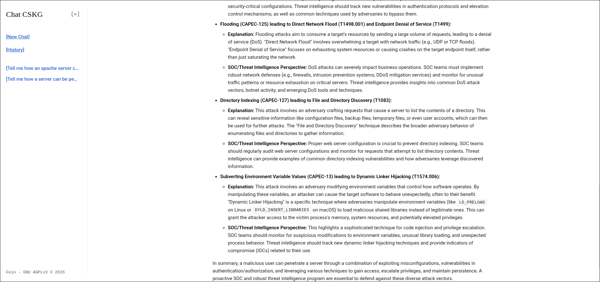

# Cybersecurity Knowledge Graph (CSKG) Pipeline

This project implements an ETL pipeline to fetch, parse, link, validate, and query cybersecurity data (CVE, CWE, CAPEC, ATT&CK) using the SEPSES ontology.


## Installation

### Prerequisites

- Python 3.8+
- Docker & Docker Compose (for the SPARQL Endpoint)
- `pip` or `pipenv`

### 1. Clone the repository

```bash
git clone https://github.com/feinru/cskg-agentic   
cd cskg-agentic
```

### 2. Configuration

Configuration is primarily handled through environment variables and `.env` files.

### Environment Variables

| Variable | Description | Required / Optional | Default Value |
| --- | --- | --- | --- |
| `GOOGLE_API_KEY` | Gemini model access for the SOC analyst chat interface. | **Required** | None |
| `NVD_API_KEY` | Optional key to bypass NVD rate limits (fetches faster). | Optional | None |
| `VIRTUOSO_HOST` | Host address of the Virtuoso SPARQL endpoint. | Optional | `localhost` (or `virtuoso` in Compose) |
| `VIRTUOSO_CONTAINER`| Name of the running Virtuoso Docker container. | Optional | `cskg-sparql` |

Rename `.env.example` to `.env` in the project root:
```bash
cp .env.example .env
```

> **Do not forget to add your `GOOGLE_API_KEY` inside the new `.env` file!** The Chat Web UI requires this key to convert user questions into SPARQL queries.

## Quick Start with Docker

The easiest way to build, run, and query the entire CSKG pipeline and web UI is using Docker Compose.

### 1. Build and Start Services
This starts Virtuoso, builds the data pipeline container, builds the Next.js web application, and automatically runs the sequential fetch-parse-link-validate-load cycle:
```bash
docker compose up --build -d
```

### 2. Verify Services
Once the pipeline container output shows completion, you can access your services:
- **Agentic Web UI (Chat)**: `http://localhost:3000`
- **SPARQL Endpoint**: `http://localhost:8890/sparql`
- **Web Admin UI**: `http://localhost:8890/conductor`

### 3. Stop Services
When you are done, you can safely shut down all the background containers without losing your database data by running:
```bash
docker compose down
```

## How to Run the Pipeline (Local/Manual)

The pipeline is modular and can also be run sequentially on your host machine without Docker.

### 1. Install Dependencies
```bash
pip install -r requirements.txt
```

### 2. Fetcher Module
Fetches raw datasets:
```bash
python modules/fetcher/main.py
```

### 3. Parser Module
Parses raw files and maps to SEPSES classes:
```bash
python modules/parser/main.py
```

### 4. Linking Module
Identifies and maps relationships:
```bash
python modules/linking/main.py
```

### 5. Validation Module
Validates semantic compliance and structure:
```bash
python modules/validation/main.py
```

### 6. SPARQL Endpoint
Start Virtuoso Database:
```bash
cd sparql
docker compose up -d
```
Load the validated TTL files:
```bash
python load.py
```
Verify the endpoint:
```bash
python verify.py
```

## Expected Outputs

- **Fetcher Module:** Raw cybersecurity data files stored in `modules/fetcher/cache/`.
- **Parser Module:** Parsed Turtle (`.ttl`) files mapped to SEPSES ontology.
- **Linking Module:** Linked Turtle files containing relationship triples, saved in `modules/linking/output/`.
- **Validation Module:** Validation reports summarizing triple counts, subjects, errors, and warnings.
- **SPARQL Endpoint:** A fully queryable Knowledge Graph at `http://localhost:8890/sparql` with named graphs such as `http://w3id.org/sepses/graph/cve`.
- **Agentic Web UI:** A Next.js frontend at `http://localhost:3000` powered by a LangChain agent that converts natural language security queries into automated SPARQL executions.


## Security Use Cases
1. **Vulnerability Attack Chain Analysis** (`CVE` -> `CWE` -> `CAPEC` -> `ATT&CK`)
2. **Exploited Vulnerability Prioritization** (`CISA KEV` -> `ICSA` -> `CVE`)
3. **ATT&CK Technique Coverage Mapping** (`CAPEC` -> `ATT&CK`)

## Known Limitations

- **Performance Constraints:** Loading very large datasets (like the full NVD dataset) into Virtuoso locally may consume significant RAM and take a long time.
- **Missing Triples:** The validation agent might flag missing mandatory triples if the upstream data source (e.g., MITRE or NVD) has incomplete entries.
- **Sequential Dependency:** The pipeline currently requires manual sequential execution. If `fetcher_agent` fails or updates partial data, downstream agents must be re-run manually.
- **Stale Data:** Fetched data is cached; you must clear the cache or adjust fetch instructions to pull the latest upstream vulnerability advisories.
- **Limited CVE & CPE Data (Demo Mode):** The CVE and CPE fetchers are currently capped at 100 records for development purposes. This causes a high error rate in `icsa_to_cve.ttl` and `cve_to_cpe.ttl` because most CVEs referenced by the ICSA are missing from the base dataset. 
  * **Fix:** Remove `MAX_DEMO = 100` in `modules/fetcher/fetchers/nvd.py` and use an NVD API key to perform a full fetch (~350K CVEs, estimated to take 2–4 hours).

## Showcase

The project features a Web UI built with Next.js, allowing SOC analysts to query the Knowledge Graph using natural language.

<p align="center">
  
  
</p>

<p align="center">
  
</p>

<p align="center">
  
  
</p>